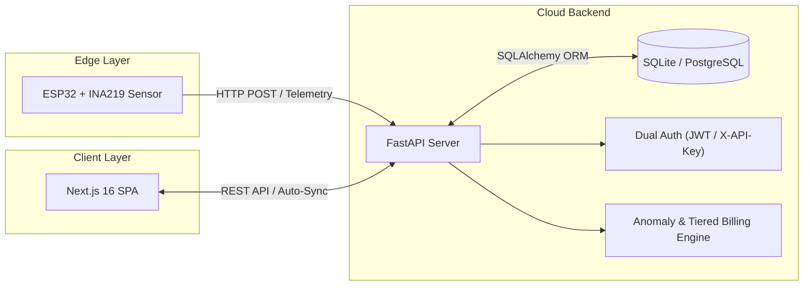

# VoltPulse — Smart Electricity System

[](https://render.com)
[](https://vercel.com)
[](https://espressif.com)

VoltPulse is an end-to-end smart electricity monitoring, management, and anomaly detection platform. It bridges physical IoT edge hardware (ESP32 DevKit V1 + INA219 high-side power monitor) with an asynchronous FastAPI cloud ingestion service and a modern Next.js 16 consumer dashboard. The system delivers sub-second telemetry sampling, non-volatile energy persistence, automated tiered slab billing, and statistical anomaly detection.

---

## 🔗 Live Demos
* **Frontend SPA:** [https://smart-electricity-system-j5lz-n7bc97jb7-codetechmangos-projects.vercel.app](https://smart-electricity-system-j5lz-n7bc97jb7-codetechmangos-projects.vercel.app)
* **Backend API Docs:** [https://smart-electricity-system.onrender.com/docs](https://smart-electricity-system.onrender.com/docs)

---

## 🏗️ System Architecture



---

## ✨ Key Features & Enhancements

* **Edge IoT Telemetry Ingestion:** Reads bus voltage, shunt voltage, load current, and instantaneous power at 1-second intervals via I²C with high-side sensing (~0.8 mA resolution).
* **NVS Flash Energy Persistence:** Numerically integrates energy ($E = \sum \frac{P \times \Delta t}{3.6 \times 10^6}$ kWh) directly on the microcontroller and commits readings to non-volatile flash storage (`Preferences.h`), preventing data loss during brownouts or reboots.
* **Dual-Layer Authentication:** Supports persistent hardware API keys (`X-API-Key`) for unattended embedded devices alongside standard OAuth2 JWT tokens with Role-Based Access Control (RBAC) for consumers and administrators.
* **High-Precision Metric Accounting:** 6-digit float precision preserves micro-kWh usage deltas from second-by-second hardware transmissions without truncation.
* **Live Telemetry Dashboard:** Auto-syncing (5-second polling) consumer portal featuring live connection heartbeats, real-time current/voltage/power indicators, and direct NVS-integrated energy monitoring.
* **Statistical Anomaly Detection:** Sliding-window Z-Score engine automatically flags sudden consumption spikes and creates actionable alerts.
* **Progressive Tiered Slab Billing:** Automatically categorizes monthly usage into tariff brackets (Tier 1: 0–100 kWh, Tier 2: 101–300 kWh, Tier 3: >300 kWh) and computes live predicted invoices.
* **Privacy-First Area Benchmarking:** Aggregates neighborhood usage percentiles and peak-hour metrics entirely at the database level, preventing demographic data leakage.

---

## 🛠️ Tech Stack

* **Edge Hardware & Firmware:** ESP32 DevKit V1, Texas Instruments INA219, C++ / Arduino Framework, `Preferences.h`, `Adafruit_INA219`, `HTTPClient`.
* **Backend:** FastAPI, Python 3.13, SQLAlchemy 2.0, SQLite (Local Dev) / PostgreSQL (Production), Pydantic v2, Uvicorn.
* **Frontend:** Next.js 16 (App Router), React 19, TypeScript, Tailwind CSS 4, Recharts, Axios.
* **DevOps:** Docker, Docker Compose, Render, Vercel.

---

## 🚀 Quick Start

### 1. Backend Service (FastAPI)
```bash
cd backend
python -m venv venv
# Windows:
.\venv\Scripts\activate
# Linux/macOS:
source venv/bin/activate

pip install -r requirements.txt
python run.py
```
*API Swagger documentation available at: `http://localhost:8000/docs`*

### 2. Frontend Client (Next.js)
```bash
cd frontend
npm install
npm run dev
```
*Dashboard available at: `http://localhost:3000`*

### 3. Firmware Flashing (ESP32)
```bash
# Compile
arduino-cli compile --fqbn esp32:esp32:esp32 firmware/voltpulse

# Upload (Hold BOOT button if connecting hangs)
arduino-cli upload -p COM15 --fqbn esp32:esp32:esp32 firmware/voltpulse

# Monitor live telemetry
arduino-cli monitor -p COM15 -c baudrate=115200
```

### 4. Docker Deployment
```bash
docker-compose up --build
```
